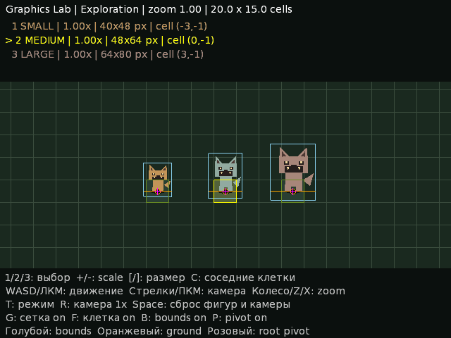
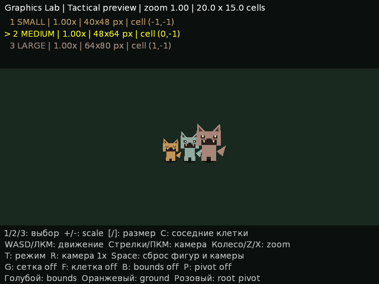
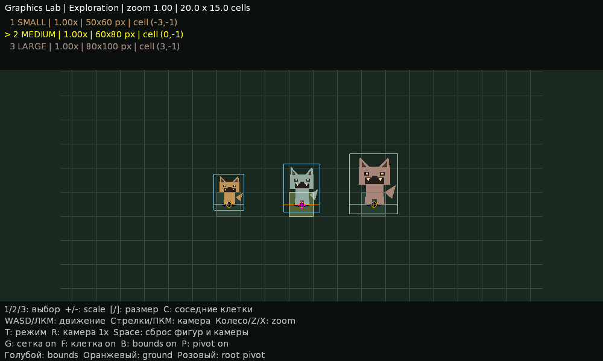

# Graphics Lab: проверка масштаба персонажей

Это эксперимент для визуального выбора размеров, **не утверждённый арт-стандарт**.
Изменение OpenSpec: `graphics-lab-character-scale`; до приёмки не архивируется.

Дополнительный эксперимент: [Facing Direction — управление, сравнение и screenshots](GRAPHICS_LAB_FACING.md).
Он не определяет окончательный индикатор и не добавляет направление в боевую модель.

## Запуск

Из корня репозитория:

```sh
./gradlew :lwjgl3:graphicsLab
```

Отдельный entry point для IDE: `GraphicsLabLauncher`, working directory `assets/`.
Обычная игра по-прежнему запускается через `./gradlew :lwjgl3:run`.
Lab не создаёт боевую симуляцию. Tactical preview сравнивает клеточное
позиционирование; HP, дистанции, collision и правила боя не меняются.

| Управление | Действие |
|---|---|
| 1 / 2 / 3, Tab | Выбрать одну из трёх фигур |
| `+` / `-` | Visual scale выбранной фигуры, шаг 0.05, диапазон 0.25–2.5 |
| `[` / `]` | Сменить её класс Small / Medium / Large |
| WASD | Плавное перемещение в exploration; шаг в одну клетку в tactical |
| ЛКМ по полю | Переместить выбранную фигуру к указателю; в tactical — в центр клетки |
| Стрелки / перетаскивание ПКМ | Pan камеры |
| Колесо / Z / X | Zoom камеры в диапазоне 0.4–2.5 |
| R | Стандартный zoom=1 и исходный центр камеры |
| Space | Сбросить три фигуры, их facing в N и камеру |
| C | Сравнить соседние клетки / разнести фигуры на три клетки |
| T | Exploration / tactical preview; вход в tactical центрирует anchors по клеткам |
| G / F / B / P | Сетка / footprint / visual bounds / ground line и pivot |
| Q / E | Повернуть facing выбранной фигуры на 45° против / по часовой стрелке |
| V / H | Arrow → Notch → Sector → Off / индикатор выбранного или всех |
| Backspace | Сбросить facing выбранного в N |
| J / K | Одиночный просмотр выбранного / показать или скрыть HUD |
| U / I | Уменьшить / увеличить угол Sector на 15°, диапазон 15–180° |
| O / L | Уменьшить / увеличить радиус Sector на 0.1 клетки, диапазон 0.25–2 |

Голубая рамка — полный визуальный контейнер (аналог границы PNG),
жёлтая/оливковая — логическая клетка. Оранжевая линия и окружность — ground line
и world ground anchor; розовый крест — root pivot, совпадающий с anchor.
Верхний HUD показывает классы, individual scale, экранные размеры контейнеров
и текущие клетки. При узком окне текст уменьшается; для оценки деталей рекомендуется
начать с исходного окна 640×480.

## Что используется в игре

- Стек: Java 8, libGDX 1.14.2, desktop LWJGL3, Android; сборка через JDK 21.
- `FirstScreen` рисует поле и участников через `ShapeRenderer`. Охотник — круг
  радиуса 0.4 world units, противник — круг радиуса 0.3. Sprite renderer пока нет.
- `OrthographicCamera`, `FitViewport(20,15)`, zoom=1. Камера следует за визуальной
  позицией охотника. В Lab те же типы renderer/камеры/viewport и общие константы
  `PrototypeViewConfig`; камера свободная для сравнения.
- Логическая клетка: **1×1 world unit**, origin=(0,0), X вправо, Y вверх.
  Это не фиксированное число пикселей: при 640×480 и zoom=1 получается **32×32 px**.
- В игре exploration и tactical используют одинаковую камеру. Вход в тактику
  размещает участников в центрах клеток; визуальный переход длится 0.22 s.
  Размер камеры не меняется. Lab воспроизводит геометрию этих представлений,
  но не процедуры входа/выхода из боя.

Проекция камеры охватывает **20×15 клеток в обоих режимах**. На границах возможны
частичные клетки, поэтому число пересекаемых ячеек может быть 21×16.
При zoom=z размер проекции — 20z×15z клеток. FitViewport сохраняет этот охват
при resize, добавляя letterbox.

| Окно, zoom=1 | Viewport | Клетка на экране | Контейнер Medium |
|---|---|---|---|
| 640×480 | 640×480 | 32×32 px | 48×64 px |
| 1000×600 | 800×600, поля по 100 px | 40×40 px | 60×80 px |
| 480×800 | 480×360, поля по 220 px | 24×24 px | 36×48 px |

HUD Lab закрывает верхние 116 px и нижние 99 px окна. При 640×480 открыто
около **20×8.28 клеток** поля, при 1000×600 — **20×9.63**; в portrait HUD
находится в letterbox и не закрывает проекцию 20×15. Это диагностический HUD Lab,
а не изменение игровой камеры. В основной игре HUD тоже накладывается поверх
проекции, причём его содержимое зависит от состояния боя.

## Габариты и anchor

Исходные числа трактуются как условные **asset pixels**, где 64 px соответствуют
одной логической клетке. Они не означают 64 экранных px при текущем стандартном окне.

| Гипотеза | Контейнер в asset pixels | В world units при scale=1 | На экране 640×480 | Pivot от верхнего левого угла |
|---|---|---|---|---|
| Small | 80×96 | 1.25×1.5 | 40×48 px | (40,81) |
| Medium | 96×128 | 1.5×2 | 48×64 px | (48,108) |
| Large | 128×160 | 2×2.5 | 64×80 px | (64,135) |

Для первого сравнения рекомендуется сохранить эти три гипотезы. Medium — удобная
отправная точка, Small позволяет оценить предел мелких деталей, Large — перекрытие
соседей. Small/Large используют относительный pivot (50% ширины, 84.375% высоты)
по аналогии с Medium; это настраиваемая гипотеза в `LabFigure`, а не игровое правило.

Рекомендуемая исходная опора Medium — **(48,108)**; ground line Y=108. Ноги доходят
до этой линии, ниже остаются 20 asset pixels контейнера. Ground anchor размещён
в world position участника (в tactical — в центре клетки). Нижний край контейнера
не совмещается с нижним краем клетки.

Преобразование локальных координат изображения (u,v), где v направлена вниз:

```text
k = visualScale * cellSize / 64
worldX = groundAnchorX + (u - pivotX) * k
worldY = groundAnchorY + (pivotY - v) * k
```

При изменении масштаба pivot остаётся на anchor. Footprint получается исключительно
через `TacticalGrid.worldToCell(anchor)`, включая отрицательные координаты.
Bounds не используются для attack range, collision или выбора занятой клетки.

## Предварительная оценка читаемости

Готового компактного волка в assets нет. Заглушка состоит из геометрических форм
`ShapeRenderer`: большая голова, уши, корпус, две лапы, хвост и крупная пасть.
Новых assets через API и новых зависимостей нет. Это проверка пропорций;
фильтрация настоящего PNG и качество будущего арта здесь не проверяются.

На кадрах 640×480, zoom=1:

- У всех трёх читаются общий силуэт, уши и тёмная пасть. Короткие лапы различимы,
  хотя диагностический крест частично закрывает опору; для чистого вида нажать P.
- Глаза Small занимают примерно 1.7×1.5 px каждый: выражение лица ненадёжно.
  У Medium — около 2×2 px, у Large — 2.7×2.5 px. Мелкие зубы уже теряются.
- Классы явно различаются по высоте. Контейнер включает пустое место: тело Medium
  от кончиков ушей до ground line занимает около 50.5 экранных px из 64 px bounds.
- Ширина контейнеров превышает клетку на 25%, 50% и 100%. При центрировании
  запас с каждой стороны составляет 0.125, 0.25 и 0.5 клетки. Реальная заглушка
  уже контейнера; режим C показывает, что хвост/голова Large могут перекрывать
  соседнюю фигуру. Footprint при этом остаётся одним.
- Масштаб и положение сохраняют опору при pan/zoom/resize. В exploration движение
  плавное; в tactical это диагностические клеточные шаги без сложных анимаций.

**Менять логическую клетку не требуется.** Стандарт «64×64 / 96×128» можно пока
использовать как систему asset coordinates с пересчётом, но не как обещание
экранных размеров. Если глазам и пасти понадобится больше деталей при 640×480,
сначала стоит визуально сравнить больший visual scale с перекрытием соседей.
Окончательный выбор размеров и pivot остаётся за владельцем после просмотра.

## Проверки и кадры

```sh
./gradlew :domain:test :core:test :android:assembleDebug
./gradlew :lwjgl3:graphicsLabSmoke
./gradlew :lwjgl3:combatRhythmSmoke :lwjgl3:tacticalBreakoutSmoke :lwjgl3:creaturePursuitSmoke
openspec validate graphics-lab-character-scale --strict --no-interactive
```

Desktop smoke требует доступного графического сеанса. Он проверяет настоящий OpenGL,
камеру, independent scale, смену класса, anchor через project/unproject и pointer,
клеточное движение, переключение представлений и слоёв, pan/zoom/reset,
landscape/portrait resize, letterbox input и восстановление InputProcessor.
Повторяемые кадры сохраняются в `lwjgl3/build/graphics-lab/`.
Unit-тесты проверяют anchor, запас ниже ground line и независимость footprint от
visual scale/класса. Android проверяется сборкой APK; запуск Lab на Android
не добавлен, ручная проверка на устройстве не проводилась.

Выполнено: 209 domain и 54 core теста без failures/errors/skips, три существующих
desktop smoke, Graphics Lab smoke, Android debug APK и строгая валидация change.

### Обычный масштаб, три размера



### Соседние клетки, без диагностических слоёв



### Wide resize с letterbox


