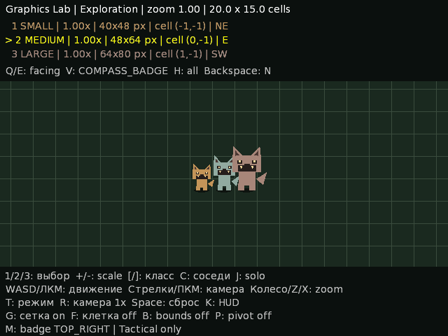
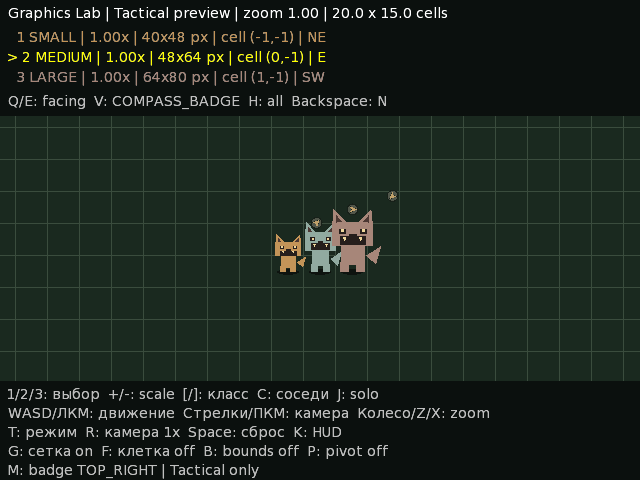
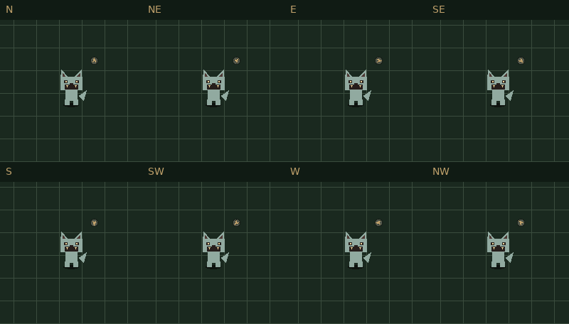
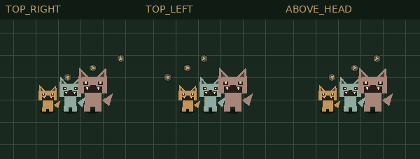
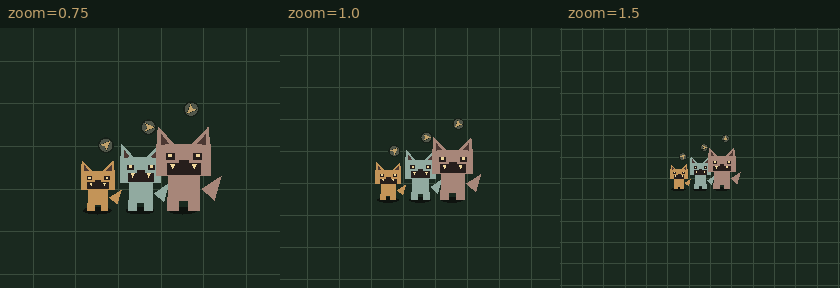
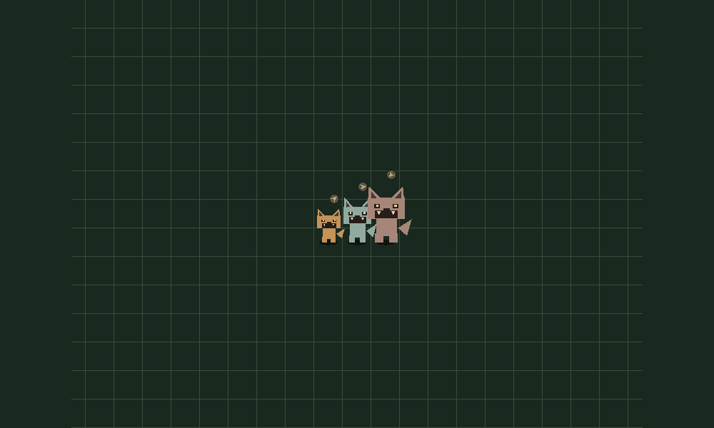
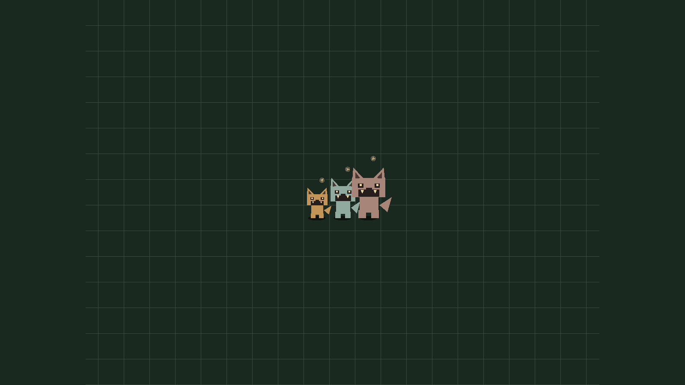

# Graphics Lab: Tactical Compass Badge

Эксперимент `graphics-lab-compass-badge` изолирован внутри Lab. Используется прежний
`Facing`, фигура остаётся анфас. Domain, combat, AI, движение и основная игра
не меняются. **Индикатор и его положение не приняты как арт-стандарт.**

## Запуск и управление

```sh
./gradlew :lwjgl3:graphicsLab
```

Из исходного состояния: T — Tactical preview; четыре нажатия V — COMPASS_BADGE.
H включает маркеры всех фигур, C ставит их на соседние клетки. Для чистого вида
отключить B/F/P, при желании G (сетку) и K (HUD). Badge сам не рисует visual bounds;
существующая диагностика B остаётся независимой.

| Клавиши | Действие |
|---|---|
| M | Top Right → Top Left → Above Head; исходно Top Right |
| Q / E | Facing выбранного на −/+45°, прежняя конвенция N/NE/E/SE/S/SW/W/NW |
| 1 / 2 / 3, Tab | Выбор фигуры; H — selected/all |
| V | Arrow → Notch → Sector → Compass Badge → Off |
| T | Exploration / Tactical preview |
| J | Solo выбранной фигуры; для восьми направлений выбрать 2 (Medium) |
| Backspace | Facing выбранного в N; Space — прежний общий сброс |

Прежние WASD, ЛКМ, pan/zoom, C, visual scale, класс и диагностика сохраняются.
HUD показывает режим, facing каждой фигуры, выбранный Kind и позицию Badge
(нижняя строка при COMPASS_BADGE). Default Kind остаётся Off.

## Строгое правило видимости

**Badge рисуется только при Tactical + COMPASS_BADGE**, с учётом selected/all.
В Exploration его нет при выборе, hover, изменении facing, позиции и движении.
T скрывает/показывает его мгновенно; facing в Exploration сохраняется и может
меняться через Q/E. Возврат в Tactical показывает актуальное направление.
Arrow/Notch/Sector и debug-слои этим правилом не ограничиваются.





## Геометрия

Значок — короткий охряный шеврон с тёмным контуром на нейтральной круглой подложке.
Нет букв, длинной стрелки или новых assets. Исходный диаметр **0.375 клетки**,
то есть **12 экранных px при 640×480/zoom=1**. Размер зависит от клетки и камеры,
но не visual scale или класса. Экранный размер ограничен **8–16 px**.
Здесь px — логические screen pixels libGDX; screenshots получены при масштабе
дисплея 1×. Фигура не меняет своих bounds, footprint или ground anchor.

Пусть r — радиус после clamp, g=0.08 клетки, bounds=(left,bottom,width,height):

| Положение | Центр X | Центр Y |
|---|---|---|
| Top Right | right + g + r | top + g + r |
| Top Left | left − g − r | top + g + r |
| Above Head | left + width/2 + 0.2 клетки | top + g + r |

Значок целиком выше собственных visual bounds; Top Right/Left также снаружи
соответствующего угла. При изменении класса/visual scale он следует реальной
рамке контейнера. Угол шеврона берётся из существующего `Facing.worldDegrees()`.
Отрисовка — world projection существующего ShapeRenderer, после всех тел и guides,
перед HUD. Сортировка тел по Y не меняется; сосед не скрывает значок своим телом,
но overlay способен закрыть часть соседнего уха или другого маркера.

## Восемь направлений и три позиции

Фрагменты настоящих кадров при 640×480, zoom=1, **без увеличения**. Добавлены только
подписи и компоновка. Один Medium, Top Right:



Соседние клетки, слева направо Small/Medium/Large, facing NE/E/SW:



Полные screenshots: [Top Right](graphics-lab/compass/top-right-640.png),
[Top Left](graphics-lab/compass/top-left-640.png),
[Above Head](graphics-lab/compass/above-head-640.png).

| Положение | Наблюдение при соседнем расположении |
|---|---|
| Top Right | Значок виден, но у маленькой фигуры попадает к уху соседнего Medium; принадлежность становится менее очевидной |
| Top Left | Свободен в показанном ряду с ростом высоты слева направо. Обратный порядок размеров способен вернуть перекрытие |
| Above Head | Лучше связывается с собственной головой, меньше уходит к соседу. В этой расстановке наиболее понятный кандидат |

**Предварительная рекомендация — Above Head для следующего визуального просмотра.**
Начальная позиция в Lab остаётся Top Right по заданию. Badge устраняет исчезновение
северных направлений под собственным телом, но при 8–12 px диагонали всё ещё требуют
внимания. Решение о финальном положении остаётся за владельцем.

## Окна, zoom и масштаб фигуры

FitViewport остаётся 20×15 world units: широкое окно даёт letterbox, а не расширяет
игровое поле. Три фигуры занимают по одной клетке при всех размерах.

| Окно | Viewport | Диаметр при zoom 0.75 / 1 / 1.5 |
|---|---|---|
| 640×480 | 640×480 | 16 / 12 / 8 px |
| 1000×600 | 800×600, поля по 100 px | 16 / 15 / 10 px |
| 1600×900 | 1200×900, поля по 200 px | 16 / 16 / 15 px |







Проверены все классы и visual scale 0.25/1/2.5: позиция следует bounds, размер
значка при одинаковой камере не меняется. На очень маленькой фигуре минимальный
размер UI может выглядеть крупным относительно головы. Увеличенная фигура может
приблизить маркер к HUD или краю viewport; автоматического сдвига внутрь экрана нет.
Разведения пересекающихся значков, clipping avoidance и привязки к конкретному
пикселю рисунка головы пока нет: опора — полный visual container с его padding.

## Проверки

```sh
./gradlew :core:test :domain:test :android:assembleDebug
./gradlew :lwjgl3:compassBadgeSmoke :lwjgl3:facingSmoke :lwjgl3:graphicsLabSmoke
./gradlew :lwjgl3:combatRhythmSmoke :lwjgl3:tacticalBreakoutSmoke :lwjgl3:creaturePursuitSmoke
openspec validate graphics-lab-compass-badge --strict --no-interactive
```

Выполнено: 63 core и 209 domain тестов без failures/errors/skips, шесть desktop
smoke, debug APK и строгая валидация OpenSpec. Пять новых unit-тестов проверяют gate,
три позиции, actual bounds для всех классов/scale, screen clamp при трёх zoom/окнах,
независимость footprint/facing и цикл положения. Восемь направлений по-прежнему
проверяются существующим FacingTest.

Compass smoke сравнивает **весь framebuffer Badge и Off в Exploration** для
трёх позиций, всех facing, выбора, hover и selected/all; дополнительно при движении
и включённых guides. В Tactical проверяет охряный glyph, восемь разных кадров
поворота для каждой позиции, переключение режима, прежние Q/E/T/C/классы и M.
Сохраняет screenshots трёх позиций при трёх zoom и трёх окнах. Кадры просмотрены
визуально; сравнения в docs собраны из фрагментов без изменения масштаба.

Оригиналы: `lwjgl3/build/graphics-lab-compass/`; создаются `compassBadgeSmoke`,
нужен графический сеанс. Android проверен сборкой APK, на устройстве не запускался.
В основную игру Compass Badge не внедрён.
