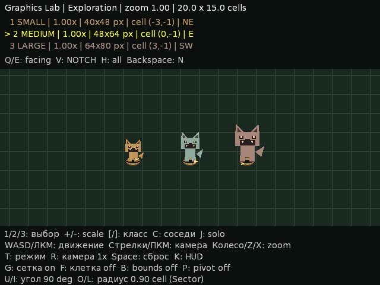
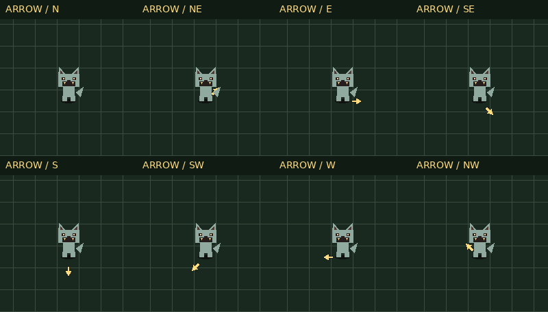
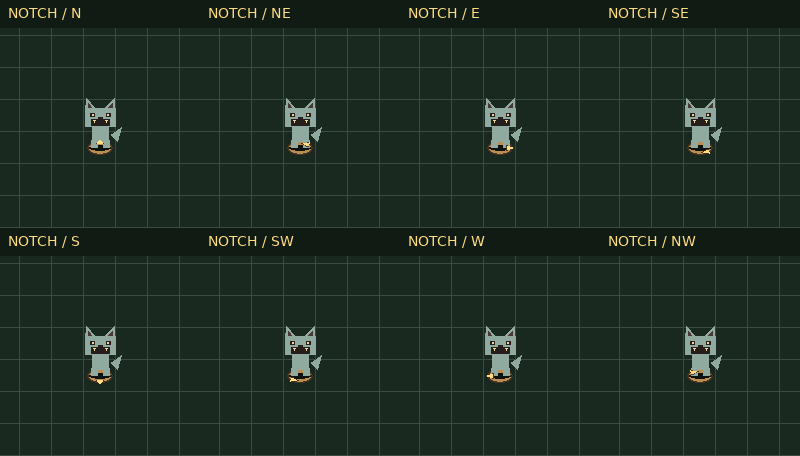
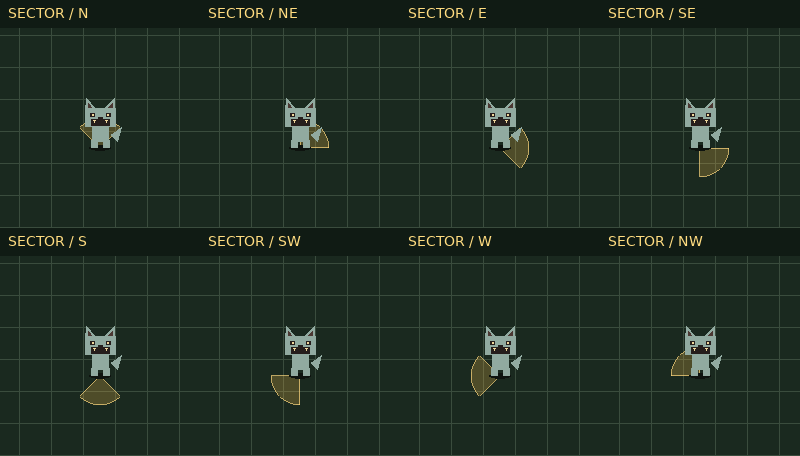
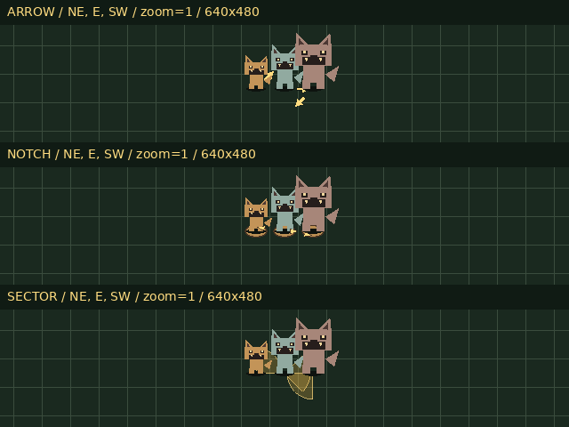
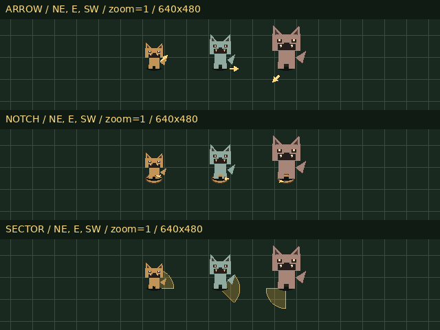
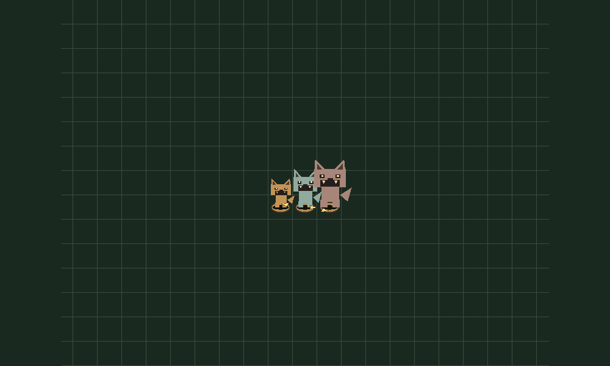
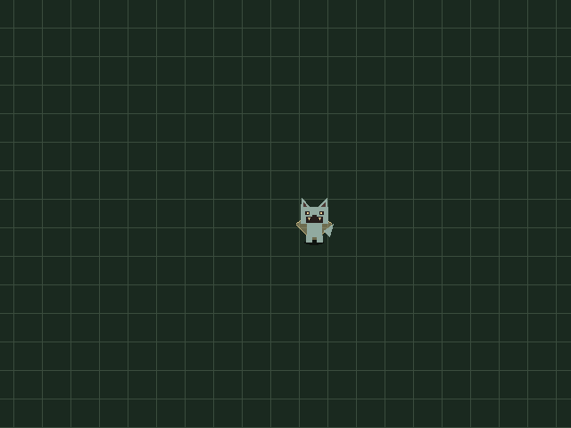

# Graphics Lab: Facing Direction

Визуальный эксперимент `graphics-lab-facing`. Domain, combat, AI, движение и
тактические правила не меняются. **Ни один вариант не утверждён как арт-стандарт.**
Дополнительно доступен [Tactical Compass Badge](GRAPHICS_LAB_COMPASS.md), который
в отличие от наземных вариантов виден исключительно в Tactical preview.

## Запуск и управление

```sh
./gradlew :lwjgl3:graphicsLab
```

Сохраняются все [прежние команды Lab](GRAPHICS_LAB.md). При запуске facing=N,
индикатор Off. N направлен вверх по world Y, E вправо по X.
Порядок по часовой стрелке: N → NE → E → SE → S → SW → W → NW → N.
Тело фигуры не поворачивается.

| Клавиши | Действие |
|---|---|
| 1 / 2 / 3, Tab | Выбрать персонажа |
| Q / E | Поворот выбранного на −45° / +45° по часовой стрелке |
| V | Arrow → Notch → Sector → Compass Badge → Off |
| M | Top Right → Top Left → Above Head для Compass Badge |
| H | Индикаторы выбранного / всех; facing каждого сохраняется отдельно |
| Backspace | Facing выбранного = N |
| Space | Прежний сброс фигур/камеры плюс facing всех = N |
| J | Оставить только выбранную фигуру; смена выбора работает и в solo |
| K | Скрыть/показать HUD для чистого сравнения |
| U / I | Угол Sector −/+15°, от 15° до 180°, исходно 90° |
| O / L | Радиус Sector −/+0.1 клетки, от 0.25 до 2, исходно 0.9 |

Чтобы увидеть один Medium: 2, J, V. Q/E проходят все направления.
Для соседей выключить solo клавишей J, нажать C, включить H и назначить
разные направления через 1/2/3 и Q/E. Для чистой оценки отключить F/B/P;
G и K позволяют убрать сетку и HUD. Текущий facing виден в строке каждой фигуры,
вариант и selected/all — в нижней строке верхнего HUD.



## Геометрия и слои

Все расстояния заданы в **долях клетки**, а не PNG/visual bounds.
Камера прежняя: zoom=1, проекция 20×15 клеток, FitViewport. При 640×480
клетка равна 32 px, при 1000×600 — 40 px, при 1600×900 — 60 px.
Широкое окно 1600×900 содержит viewport 1200×900 с полями по 200 px:
горизонтальный охват поля не расширяется. На другом zoom индикаторы меняют
экранный размер вместе с миром, без компенсации в screen pixels.

- **Arrow:** контрастная светлая стрелка с тёмной окантовкой. Основание на расстоянии
  0.44 клетки от anchor, кончик на 0.88 клетки. Рисуется под телом своей фигуры,
  поэтому не закрывает морду и корпус. На изображение не наносится.
- **Notch:** деревянная эллиптическая подставка шириной 0.8 и высотой 0.44 клетки;
  светлый треугольник имеет кончик на радиусе 0.47 клетки (с окантовкой — 0.5).
  Y сплющен коэффициентом 0.55 для вида подставки. Подставка рисуется под своей
  фигурой; выступ — после её тела, как светлая кромка, поэтому может немного
  накладываться на низ корпуса/лап. Это явный визуальный компромисс для видимости N.
- **Sector:** центр строго в anchor, угол относительно facing, радиус в клетках.
  Alpha заливки 0.23, кромки 0.7. Общий pass до всех фигур, так что сектор не
  тонирует тела соседей. OpenGL blending и его факторы восстанавливаются после pass.

Для Arrow/Notch сохраняется существующий порядок фигур по убыванию Y:
земля фигуры → тело → кромка Notch → следующая фигура. Размер/класс/scale
фигуры не меняет геометрию индикатора. Facing не участвует в footprint, bounds,
сортировке, движении, атаке или обзоре.

## Сравнение при zoom=1

Ниже фрагменты настоящих OpenGL screenshots при 640×480 **без увеличения**.
Для таблиц кадров добавлены только подписи и компоновка; лица не перерисованы.

### Arrow: один Medium, восемь направлений



### Notch: один Medium, восемь направлений



### Sector: один Medium, восемь направлений



### Соседние клетки и разные размеры

Слева направо Small/Medium/Large с facing NE/E/SW. В каждом блоке сравнения
visual scale=1, footprint каждого — одна клетка.





| Вариант | Читаемость и шум | Недостатки |
|---|---|---|
| Arrow | E/W и южные направления однозначны, высокая контрастность | N скрыт собственным телом; NE/NW частично перекрываются. У соседей E может скрыться под соседней фигурой. Для постоянной индикации недостаточно надёжен |
| Notch | Самый компактный; подставка соответствует деревянной фигурке. В горизонтальном ряду соседей светлые выступы сохраняются | На 32 px/клетку N и северные диагонали мелкие, требуют внимания. При zoom-out различие хуже; светлая кромка касается лап. Передняя фигура по Y может закрыть подставку задней |
| Sector | Направление обычно видно по свободной части сектора; регулируемые угол и радиус | Больше визуального шума. Северная часть закрыта телом; у соседей сектора скрываются и накладываются. Похож на зону атаки/обзора, хотя расчётов нет |

**Рекомендация для следующего просмотра — Notch**: он занимает меньше поля и
лучше сочетается с деревянной фигуркой. Приоритет однозначности требует отдельно
оценить N/NE/NW и плотные ряды по Y на будущем арте. Универсальной видимости при
любом перекрытии и любом zoom этот эксперимент не обещает. Sector полезнее как
дополнительная подсказка для выбранной фигуры; Arrow в текущем анфасе не стоит
выбирать единственным постоянным индикатором. Это рекомендация для обсуждения,
не выбранный стандарт; default остаётся Off.

### Другие окна и движение




В больших окнах выступ различается лучше. При zoom-out=1.5 его пиксельный размер
уменьшается; при zoom-in=0.6 увеличивается. Изменение Large до visual scale=2
сохраняет размер его подставки: это проверяет независимость от visual bounds,
но показывает, что большое тело способно закрыть значительную часть основания.



В smoke сначала применяется настоящий Input-контракт с удерживаемой D в
exploration, затем клеточный шаг D в tactical preview. Оба перемещают Medium
вправо, сохраняя N. На кадре показано положение после движения с северным Sector.

## Проверки

```sh
./gradlew :core:test :domain:test :android:assembleDebug
./gradlew :lwjgl3:facingSmoke :lwjgl3:graphicsLabSmoke
./gradlew :lwjgl3:combatRhythmSmoke :lwjgl3:tacticalBreakoutSmoke :lwjgl3:creaturePursuitSmoke
openspec validate graphics-lab-facing --strict --no-interactive
```

Выполнено: 58 core и 209 domain тестов без failures/errors/skips; пять desktop
OpenGL smoke; сборка Android debug APK. Четыре новых unit-теста проверяют углы
и векторы восьми направлений, оба направления поворота и wraparound, независимость
от движения/snap/scale, неизменность anchor/footprint/bounds и настройки Sector.
Facing smoke проверяет все 24 сочетания, solo/all/Off/reset, размеры, соседей,
visual scale=2, zoom=0.6/1/1.5, окна 640×480/1000×600/1600×900, независимость
движения и восстановление GL blending. Кадры визуально просмотрены.
Дополнительная pixel-проверка сравнивает контрольную точку каждого южного
индикатора на земле для трёх классов и visual scale=0.25/1/2.5: точка остаётся
закрашена тем же цветом независимо от размера тела.

Оригиналы всех кадров: `lwjgl3/build/graphics-lab-facing/` (создаются `facingSmoke`).
Desktop smoke требует графического сеанса. Lab остаётся desktop-экспериментом;
APK собран, ручной проверки на Android-устройстве не было. Мелкие отличия
растеризации на другом GPU и будущая PNG-графика требуют отдельного просмотра.
