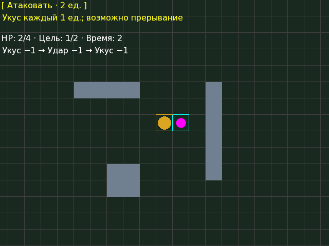

# Проверка реализации first-tactical-attack

Реализован утверждённый профиль R1–R6. Числа остаются временным балансом прототипа. Владелец разрешил завершение change запросом на sync/archive после отчёта о реализации PR #21. Main specs синхронизированы; change архивирован с сохранением невыполненных проверок 5.2 и 5.3.

## Реализация

- HP копируются с actor state; атака/шаг готовят все изменения HP, фактического времени, позиции, immutable результата и occupancy до публикации в однопоточной сцене. Отказ ничего не меняет. `Math.addExact` проверяет часы до публикации.
- Удар занимает 2 единицы, шаг 1. Укус на каждой границе — только профиль текущего прототипного существа. Эффект охотника выполняется первым на равном сроке; поражение охотника до удара отменяет остаток и оплачивает фактическое время. Scheduler/event bus/ECS/общая инициатива не добавлены.
- Восемь соседей проверяются безопасными long-разностями; LOS центров на общей геометрии блокирует пересечение и касание AABB. Радиусы не расширяют дальность. Движение по-прежнему проверяет полный путь круга.
- После поражения существа `TacticalPlacement.hunterOnly` сохраняет занятую клетку охотника; Optional явно сообщает отсутствие creature occupant. Старый двухместный конструктор по-прежнему запрещает null/совпадение. Тело видно, но не блокирует клетку; last-seen хранится, указатель скрывается. Поражённый охотник остаётся occupant; режим остаётся tactical.
- Общий InputAdapter: выбор клетки живой цели, отдельный новый click/tap на кнопке «Атаковать», причина недоступности. HUD hit-test до unproject карты; свободная клетка сохраняет прямой шаг. Удержание, дополнительные pointers и busy-ввод не повторяют команду; callbacks показа не применяют damage.
- Сохранены transitions 220/180 мс, камера по визуальной позиции и resize; показ атаки 240 мс отделён от игровых часов. Pause/hide/cancel сбрасывают pointer/selection. Добавлен DejaVu Sans с лицензией для русского UI.

## Выполненные проверки

Команда: `./gradlew :domain:test :core:test :core:classes :lwjgl3:classes android:assembleDebug android:lint --console=plain` — exit 0.

JUnit XML: domain — 113 tests, core — 22 tests; failures/errors/skipped = 0. Дополнительный `./gradlew :domain:test` с проверкой противоположных пределов int — exit 0; приведено итоговое число domain tests.

Domain checks: две последовательные атаки 4/2 HP, порядок bite/hit/bite, летальная реакция на первой единице, атомарные отказы и freeze, шаг в/из дальности и поражение от реакции на шаг, ход в клетку тела, копирование HP, clamp к 0, readonly result, ортогональ/диагональ/тонкая стена/касание угла, свободная линия при блокированном пути тела, другой масштаб сетки/радиусы.

Core checks: общий pointer route, selection без атаки, release/new press, кнопка без сквозного шага, busy и same-batch повторения, NaN/большой delta, ход после поражения цели, pause/context dismiss. Существующие тесты entry/move/camera/resize/FitViewport также прошли.

Desktop OpenGL smoke: `./gradlew -I qa/attack/smoke.gradle :lwjgl3:attackSmoke --console=plain` — exit 0, `ATTACK_SMOKE_OK: victory, interruption, pointer, resize`. Воспроизводимый harness находится в `qa/attack/`; он открывает реальное LWJGL окно и подаёт pointer-события, проверяет победу, прерывание, no-double-apply, освобождённую клетку и resize. Это автоматический smoke, не ручной playtest. Скриншот просмотрен: русский текст читаем, видны HP, цена/подсказка и результат. Снимок создаётся harness в `/tmp/hhg-qa/attack.png`.

Android: `android/build/outputs/apk/debug/android-debug.apk` собран. Lint: 0 errors, 8 warnings в manifest/icons (RedundantLabel, VectorRaster, DiscouragedApi и др.); отчёты в `android/build/reports/`. Эти файлы сборки не входят в Git.

## Ограничения, сохранённые при архивировании

- `adb devices -l` — список пуст. Проверка на Android device/emulator (физический touch, multitouch, pause/resume и восприятие размеров кнопки) не выполнена; общий libGDX pointer-контракт покрыт core-тестами. Задача 5.3 остаётся открыта.
- Ручной desktop playtest полного сценария auto-entry/боя и оценки удобства не выполнен. Автоматический OpenGL smoke и regression tests его не заменяют; задача 5.2 остаётся открыта.
- Приёмка для завершения change (5.5) зафиксирована по явному запросу владельца на sync/archive. Это не свидетельство выполнения ручных проверок. Часы пока только tactical, нет exploration/offscreen симуляции, преследования, выхода из tactical или рестарта. Это границы утверждённого среза.
- `openspec validate first-tactical-attack --strict --no-interactive` и `git diff --check` прошли при завершении change; Gradle сообщает предупреждения о Java 8 source/target и deprecated API smoke harness.
