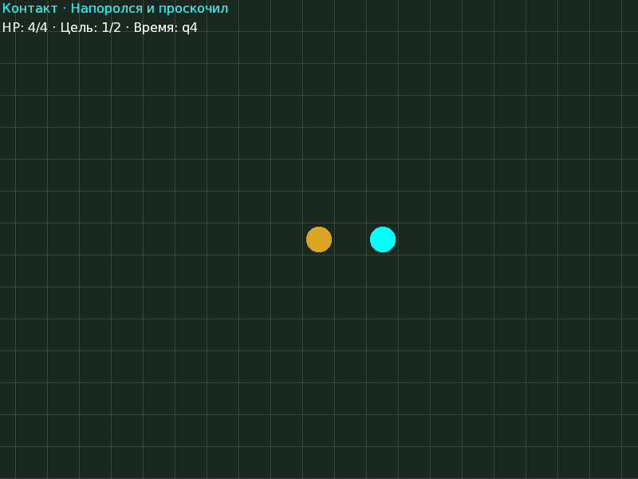
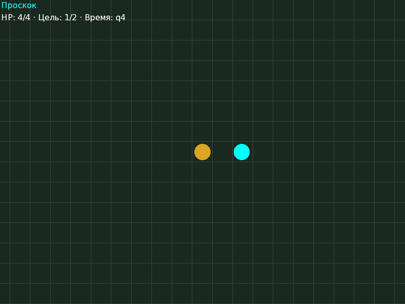
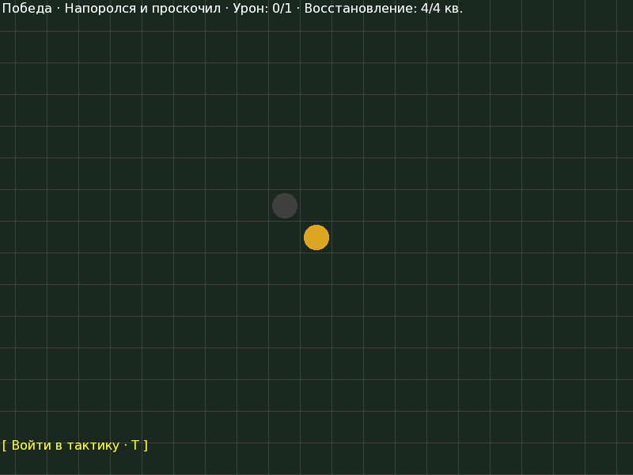

# Проверка причинного playback

## База и воспроизведение дефекта

Проверен актуальный origin/main 913d073, PR #54 и смерженный документационный PR #55.
Main уже содержит задачи 3–4: READY/STEPPING/PREPARING/IN_FLIGHT/RECOVERING,
платное сближение, ограниченный фланг, повторное решение после recovery и отсутствие
HOLD_BRACE/SPENT. Этот цикл сохранён.

До исправления SpearClash возвращал весь путь W → C → конечная клетка одной
последовательностью без индекса контакта. WorldSceneState применял конечную позицию и
урон на q4, а SpearPlayback интерполировал весь путь до q4. Для REPELLED начало и конец
совпадают, поэтому недостаточная детализация легко выглядит как отсутствие движения.
FirstScreen рисовал цвет мёртвого тела из уже применённого HP; терминальная сцена
также переключала HUD на exploration до окончания показа.

Теперь факт содержит индекс контакта и HP после события. Подход занимает прежний
боевой интервал; контакт показывается 180 мс, каждый последующий участок — 160 мс.
Последнему положению отведены ещё 200 мс. Это параметры presentation, не боевые
длительности. Урон, конечные позиции и occupancy применяются в domain на прежнем
дедлайне. HP в HUD — read-only проекция фактов; симуляция их не читает.
Летальная окраска и сообщение смерти появляются после соответствующего движения.
HUD контакта сохраняется и при уже опубликованном победном exploration.

## Автоматические проверки

Полный прогон завершился с exit 0:

    ./gradlew :domain:test :core:test :core:classes :lwjgl3:classes       :lwjgl3:boarSpearWolfClashSmoke :lwjgl3:combatRhythmSmoke       :lwjgl3:tacticalBreakoutSmoke :lwjgl3:creaturePursuitSmoke :android:assembleDebug

JUnit: domain 228, core 63, без ошибок, отказов и пропусков.
Включены preview/apply, атомарность, три исхода, летальные контакты,
геометрия, повторный цикл и эталон обычного TacticalTimelineTraceTest.
SpearPlaybackTest проверяет подход, контактную паузу, все последующие узлы маршрута,
отложенную видимость смерти и совпадение конечных позиций с фактами.
SpearClashPointerTest проверяет разные render delta, pause/resize и отсутствие
повтора удержанного ввода через последний кадр; ожидание терминального gate
обновлено под полную длительность физического показа.

Desktop действительно запускался с OpenGL:
BOAR_SPEAR_WOLF_CLASH_SMOKE_OK, COMBAT_RHYTHM_SMOKE_OK W/D/C,
TACTICAL_BREAKOUT_SMOKE_OK F1-F8/F6-death, CREATURE_PURSUIT_SMOKE_OK.
Новый smoke проверяет наличие отдельных кадров подхода, контакта и исходящего
движения. После проверки кадров дополнительно исправлен HUD терминального playback,
повторены core:test и boarSpearWolfClashSmoke.
APK собирается; adb devices -l не обнаружил устройств.
Touch и ориентация на физическом Android не проверены.

## Повторяемые Desktop-сценарии

    ./gradlew :lwjgl3:boarSpearWolfClashSmoke

Автоматически проходят 3/1/0, side, approach, flank, repeat, lethal-3, lethal-1,
lethal-side. Ожидаемые контрольные результаты:

| Сценарий | Конец domain | HP охотник/волк | Позиция волка |
| --- | --- | --- | --- |
| 3 | q6 | 4/1 | (3,0) |
| 1 | q8 | 4/1 | (-1,1) |
| 0 | q10 | 4/2 | (1,0) |
| side | q6 | 3/2 | (0,1) |
| approach | q10 | 4/1 | (3,0) |
| flank | q4, SIDE_THREAT | 4/2 | (0,2) |
| repeat, второй обмен | q16 | 3/1 | (1,0) |
| lethal-3 | q4 | 4/0 | (3,0) |
| lethal-1 | q4 | 4/0 | (-1,1) |
| lethal-side | q4 | 0/2 | (0,1) |

Для ручной игры:

    ./gradlew :lwjgl3:boarSpearWolfClashSmoke --args=random

R создаёт новую сцену с новым seed. Значение SPEAR_SEED печатается в console;
любое числовое значение можно передать через --args для повторения прямой сцены.
Аргументы 3/1/0 также сохранены как именованные fixtures.
Для смертельных случаев использовать --args=lethal-3, --args=lethal-1,
--args=lethal-side. Выбрать «Выставить», затем «Подтвердить».
В BROKE_THROUGH урон волку равен нулю: летальность самого исхода невозможна
по согласованным правилам и не добавлялась.

Кадры находятся в lwjgl3/build/boar-wolf-loop-{flight,contact,aftermath,result}-*.png,
preview сохраняется отдельно. Проверены изображения PASS в portrait 480×800,
LETHAL_PASS и LETHAL_SIDE в landscape 800×600: контакт предшествует проскоку,
тело занимает конец пути после движения. Это проверка реального renderer,
а не вывод только из domain JUnit. Игровая приёмка владельцем остаётся отдельным шагом.

Сохранённые кадры для ревью:

| Контакт | Проскок | Тело |
| --- | --- | --- |
|  |  |  |

[Контакт в portrait](playback-frames/contact-PASS.png).
